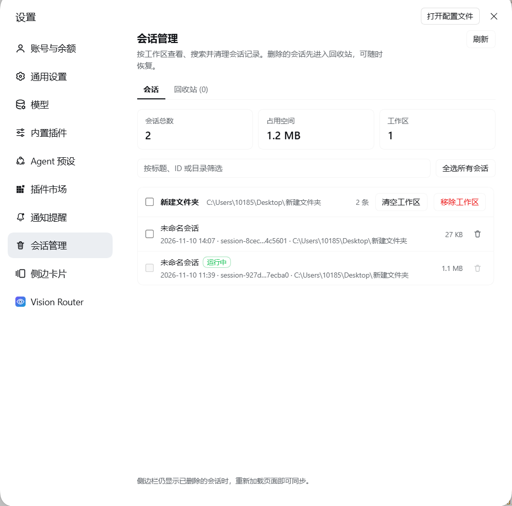
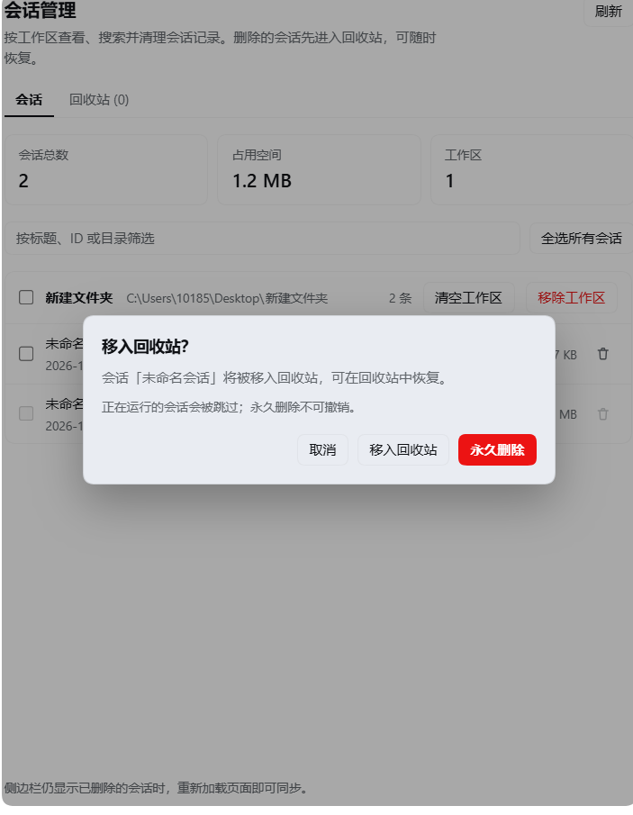
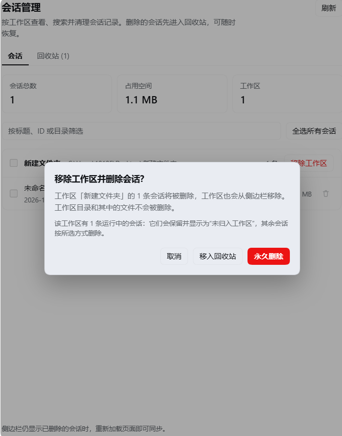
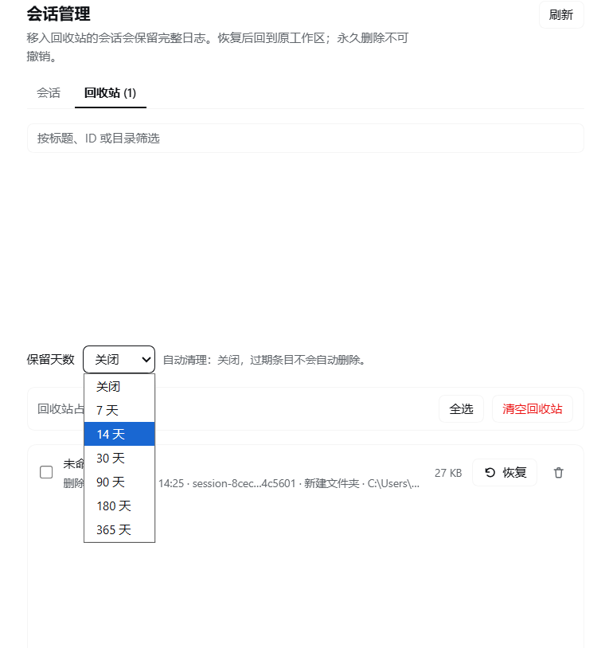

# DSH Session Manager

A [DeepSeek Harness](https://github.com/deepseek-ai/deepseek-harness) plugin that puts session history under control: browse stored sessions per workspace, search them, move them to a recycle bin or delete them permanently, clear a whole workspace, and remove a workspace from the sidebar in one step.


English | [中文](README.zh.md)

## Features

- **A dedicated Settings page** — **Settings → Session manager** lists every stored session grouped by workspace, with total session count, disk usage, and workspace count.
- **Search** — filter by session title, session ID, or directory.
- **Delete with a safety net** — every deletion starts with a confirmation that offers **Move to recycle bin** (recoverable) or **Permanently delete** (irreversible).
- **Bulk operations** — check individual sessions, a whole workspace (the checkbox in its header), or every session at once, then delete the selection in one request.
- **Recycle bin** — restore sessions to their original directory and workspace, permanently delete single entries, multi-select and delete, or empty the whole bin.
- **Retention policy** — a dropdown on the recycle-bin tab (off / 7 / 14 / 30 / 90 / 180 / 365 days). It is persisted to this plugin's config through the Harness config editor; expired entries are purged the next time the page is opened.
- **Remove a workspace** — deletes the workspace's sessions *and* removes the workspace registration from the sidebar, while **never touching the workspace folder or its files**. Live sessions are kept and become ungrouped.
- **Running sessions are protected** — a session that is currently running is skipped by every deletion path, so the conversation you are in is never removed underneath you.
- **Bilingual and theme-aware** — Chinese and English copy, rendered with the host theme tokens; no bundled React, no build step.

## Screenshots

### Sessions by workspace



### Delete: recycle bin or permanent



### Remove a workspace and its sessions



### Recycle bin and retention policy



## Installation

1. Clone this repository:

   ```bash
   git clone https://github.com/<your-account>/dsh-session-manager.git
   ```

2. In the Harness, open **Settings → Plugins** and install the cloned directory as a **local bundle**.
   The bundle's `cordis.patch.yml` inserts the `session-manager` plugin row; no configuration is required.
   When driving Harness through an agent, ask it to install the bundle from the checkout directory instead.

3. Refresh the page once, then open **Settings → Session manager**.

The plugin activates with the Web GUI: it needs `webServer`, `sessionQuery`, `sessionPersistence`, `workspaceRegistry`, and `agents`, which the desktop profile provides. `configEditor` is used for the retention dropdown.

## How it works

The bundle has two halves:

| File | Role |
|---|---|
| `index.js` | Host plugin. Registers an exact HTTP route, lists sessions through `sessionQuery`, resolves each log directory through `sessionPersistence`, and performs moves and deletions with path checks. |
| `client.js` | Browser plugin. Registers a `settings.section` page and its icon, then renders the UI with React from the host module table. |
| `cordis.patch.yml` | Inserts the plugin row and the default config. |
| `locale/*.json` | Plugin Manager title and description. |
| `icon.svg` | Plugin artwork. |

**Deletion pipeline.** A session's log directory is located through `sessionPersistence.stat()`, validated (expected log file name, at least one log file present, directory inside the log store), detached from the owning workspace and unarchived, and only then removed. `Move to recycle bin` relocates the directory to:

```text
<sessions-root>/.dsh-session-trash/<timestamp>-<session-id>-<random>/
  manifest.json    # session id, title, cwd, original path, size, deletion time
  log/             # the original session directory
```

`Permanently delete` removes the session directory instead. A workspace's empty project directory is cleaned up as well.

**Restore** validates the manifest's original path against its recorded log store, refuses to overwrite an existing directory, moves the log back, and re-attaches the session to its workspace.

**HTTP route.** The browser talks to the Host through `/api/dsh-session-manager`. The route accepts loopback requests only and requires the `x-dsh-session-manager: 1` header; every mutation requires JSON. Route handlers never expose a session's log contents to the page.

## Configuration

| Key | Default | Meaning |
|---|---|---|
| `trashRetentionDays` | `0` | Purge recycle-bin entries older than this many days whenever the page is opened. `0` disables automatic cleanup. Values are clamped to 1–3650; invalid values fall back to off. |

```yaml
- insert:
    - id: session-manager
      name: '@local/session-manager'
      config:
        trashRetentionDays: 30
```

The retention dropdown in the UI writes this same field through the Host config editor; when the value equals the bundle default (`0`), the override is removed again.

## Safety notes

- Deletion is destructive. **Permanently delete** and **Empty recycle bin** cannot be undone.
- Sessions that are running are never deleted; the UI reports how many were skipped.
- Removing a workspace deletes its session logs and its sidebar registration, **not** its directory or project files.
- A session's workspace is re-attached on restore; if the workspace registration was removed in the meantime, the session returns as ungrouped.
- Recovery from a permanent deletion is only possible through your own filesystem backups; the plugin keeps nothing after a purge.

## Compatibility

- Tested with DeepSeek Harness **0.2.2-rc.1** (Windows desktop profile).
- Uses the public host services `webServer`, `sessionQuery`, `sessionPersistence`, `workspaceRegistry`, `agents`, `configEditor`, and the `settings.section` / `settings.section.icon` client slots.
- Plain ESM JavaScript — no build step, no runtime dependencies, no bundled React.

## Development

The plugin is a single local bundle. After editing, reinstall or reload it through the plugin manager, then refresh the page:

- Host changes are picked up when the plugin row restarts.
- Client changes require a page refresh (the bundle is served from `client.js`).

The repository contains no test framework; behavior was verified with throwaway Harness sessions (move, restore, purge, permanent delete, workspace removal) and structural rendering checks of the browser half.

## License

[MIT](LICENSE)
