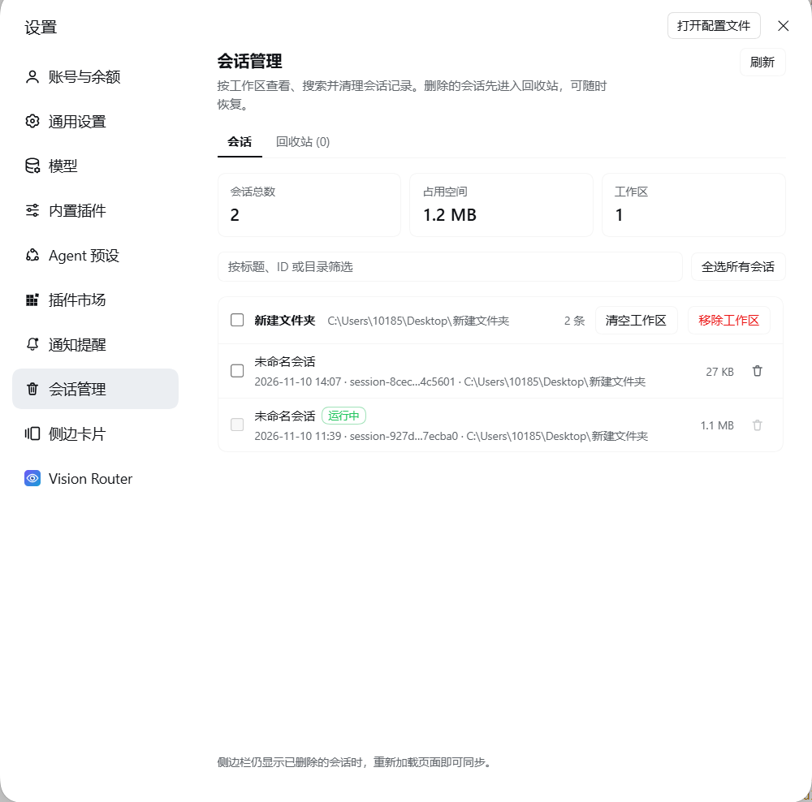
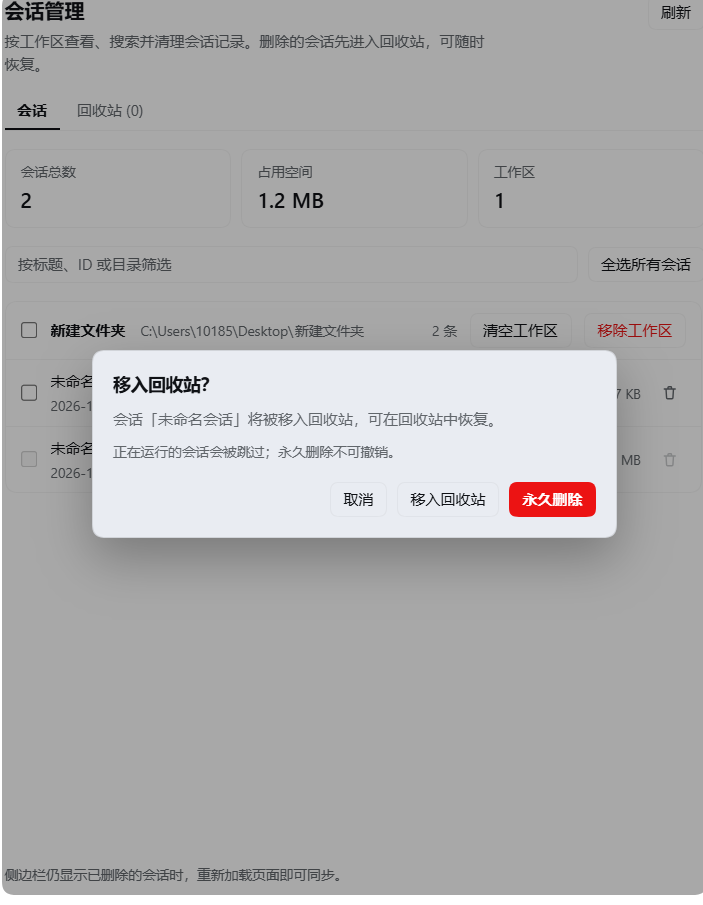
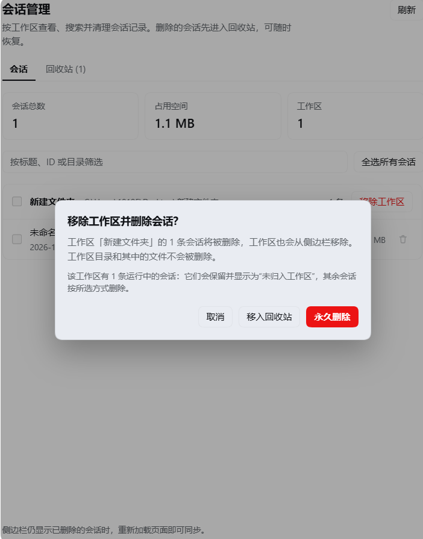
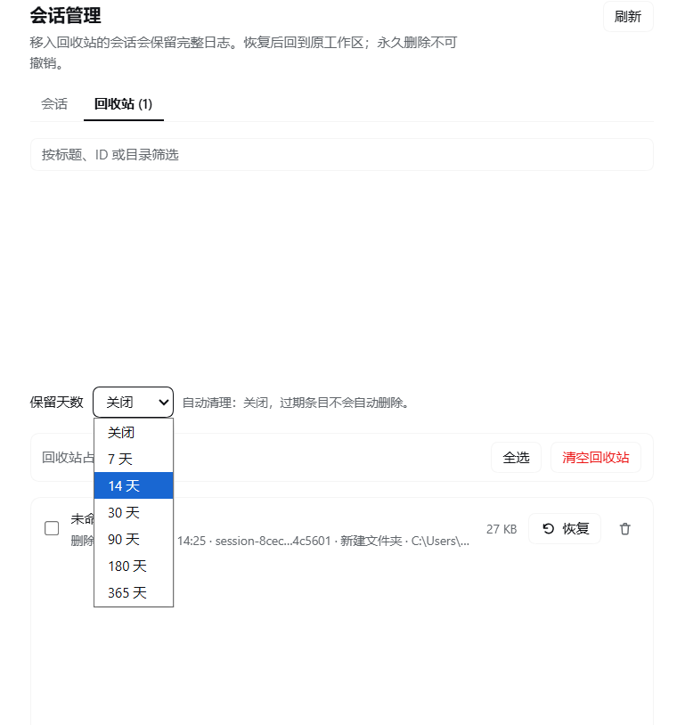

# DSH 会话管理器

一个 [DeepSeek Harness](https://github.com/deepseek-ai/deepseek-harness) 插件，用来管理会话历史：按工作区浏览、搜索会话，移入回收站或永久删除，一键清空整个工作区，甚至把工作区从侧边栏移除。


[English](README.md) | 中文

## 功能

- **独立的设置页** — **设置 → 会话管理** 按工作区分组列出所有已存储会话，并显示会话总数、磁盘占用和工作区数量。
- **搜索** — 按会话标题、会话 ID 或目录筛选。
- **带安全网的删除** — 每次删除都先弹确认框，可选择 **移入回收站**（可恢复）或 **永久删除**（不可恢复）。
- **批量操作** — 可勾选单条会话、整个工作区（标题栏复选框）或全部会话，一次请求完成删除。
- **回收站** — 恢复到原目录和原工作区、逐条永久删除、多选永久删除、清空回收站。
- **保留策略** — 回收站页的下拉框（关闭 / 7 / 14 / 30 / 90 / 180 / 365 天），通过 Harness 配置编辑器写入插件配置；下次打开页面时清理过期条目。
- **移除工作区** — 删除该工作区的会话**并**从侧边栏移除工作区注册，但**始终不删除工作区目录和文件**；运行中的会话会保留，变成“未归入工作区”。
- **保护运行中的会话** — 任何删除路径都会跳过正在运行的会话，不会把当前对话删掉。
- **中英双语、跟随主题** — 使用宿主主题 token；不打包 React，无需构建。

## 截图

### 按工作区浏览会话



### 删除：移入回收站或永久删除



### 移除工作区及其会话



### 回收站与保留策略



## 安装

1. 克隆仓库：

   ```bash
   git clone https://github.com/ysthink/dsh-session-manager.git
   ```

2. 在 Harness 中打开 **设置 → 插件**，把克隆下来的目录作为**本地 bundle** 安装。
   插件的 `cordis.patch.yml` 会插入 `session-manager` 行，默认配置即可运行。
   如果通过 Agent 操作 Harness，也可以直接让 Agent 从该目录安装 bundle。

3. 刷新页面一次，然后打开 **设置 → 会话管理**。

插件随 Web GUI 激活，依赖桌面 profile 提供的 `webServer`、`sessionQuery`、`sessionPersistence`、`workspaceRegistry`、`agents`；保留策略下拉框使用 `configEditor`。

## 实现说明

| 文件 | 作用 |
|---|---|
| `index.js` | Host 端：注册精确 HTTP 路由，通过 `sessionQuery` 列出会话、`sessionPersistence` 定位日志目录，并在带路径校验的前提下执行移动与删除。 |
| `client.js` | 浏览器端：注册 `settings.section` 页面与图标，使用宿主模块表里的 React 渲染界面。 |
| `cordis.patch.yml` | 插入插件行与默认配置。 |
| `locale/*.json` | 插件管理器中显示的标题与描述。 |
| `icon.svg` | 插件图标。 |

**删除流程**：先通过 `sessionPersistence.stat()` 定位日志目录并校验（日志文件名、目录内确有日志、目录位于日志根下），再从工作区解除归属并取消归档，最后才移动或删除。`移入回收站` 会把会话目录移动到：

```text
<会话根目录>/.dsh-session-trash/<时间戳>-<会话ID>-<随机串>/
  manifest.json    # 会话 ID、标题、原目录、原路径、大小、删除时间
  log/             # 原会话目录
```

`永久删除` 则直接删除会话目录；工作区目录清空后顺带清理空的项目目录。

**恢复**会校验 manifest 中的原路径必须位于其记录的日志根内，拒绝覆盖已存在的目录，移动回原位后重新挂回工作区。

**HTTP 路由**：页面通过 `/api/dsh-session-manager` 调用 Host；只接受回环地址请求，并要求 `x-dsh-session-manager: 1` 请求头，所有写操作必须使用 JSON。路由不会把会话日志内容暴露给页面。

## 配置

| 配置项 | 默认值 | 含义 |
|---|---|---|
| `trashRetentionDays` | `0` | 打开页面时清理超过该天数的回收站条目。`0` 表示关闭自动清理。取值收敛到 1–3650，非法值按关闭处理。 |

```yaml
- insert:
    - id: session-manager
      name: '@local/session-manager'
      config:
        trashRetentionDays: 30
```

界面上的“保留天数”下拉框会通过 Host 配置编辑器写入同一字段；当值等于 bundle 默认值（`0`）时，覆盖项会被移除。

## 安全说明

- 删除是破坏性操作：**永久删除**和**清空回收站**无法撤销。
- 运行中的会话永远不会被删除；界面会提示跳过了多少条。
- 移除工作区会删除其中的会话日志和侧边栏注册，但**不会**删除工作区目录或项目文件。
- 恢复会话时会尽量重新挂回原工作区；如果期间工作区已被移除，会话会以“未归入工作区”的形式回归。
- 永久删除后的恢复只能依赖你自己的文件系统备份；插件不会保留任何副本。

## 兼容性

- 已在 DeepSeek Harness **0.2.2-rc.1**（Windows 桌面 profile）上实测。
- 使用 Host 服务 `webServer`、`sessionQuery`、`sessionPersistence`、`workspaceRegistry`、`agents`、`configEditor`，以及客户端插槽 `settings.section` / `settings.section.icon`。
- 纯 ESM JavaScript：无构建步骤、无运行时依赖、不打包 React。

## 开发

这是一个本地 bundle。修改后通过插件管理器重装或重载插件，再刷新页面：

- Host 改动在插件行重启后生效。
- 客户端改动需要刷新页面（bundle 直接由 `client.js` 提供）。

仓库没有测试框架；行为通过一次性 Harness 会话（移入、恢复、清空、永久删除、移除工作区）和浏览器端结构渲染检查验证。

## 许可证

[MIT](LICENSE)
